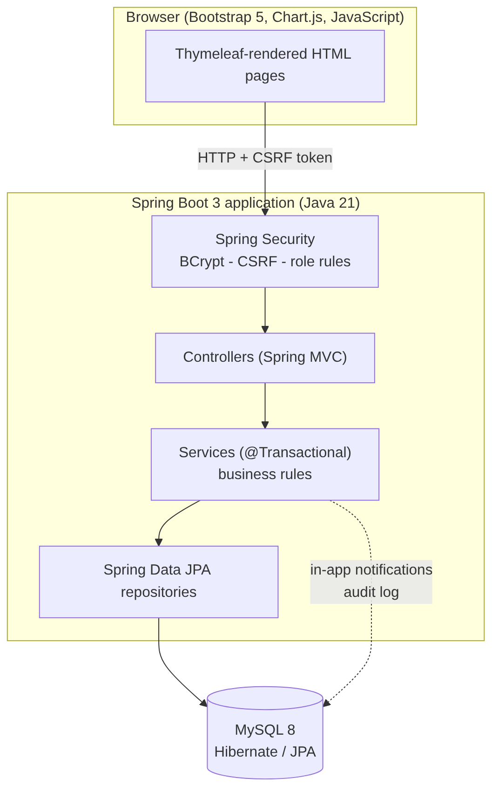

# System Architecture

LifeLink is a three-layer Spring Boot web application (Java 21) with a MySQL 8 database.

## Layers
1. **Presentation (frontend/)** - Thymeleaf pages (`frontend/pages`), shared layout fragments (`frontend/components`), CSS, JavaScript and images. Bootstrap 5, Bootstrap Icons, Chart.js and qrcode.js are loaded from CDNs.
2. **Business (backend/)** - Spring MVC controllers handle requests and validation; services hold business rules and are `@Transactional`; Spring Security protects URLs.
3. **Data (database/)** - Spring Data JPA repositories over MySQL via Hibernate.

## How the folders map to Spring Boot
Spring Boot expects `src/main/java`, `templates/` and `static/`. To keep a clear project layout, `pom.xml` declares:

| Folder in project | Becomes on the classpath |
|---|---|
| `backend/src/main/java` | compiled Java classes |
| `backend/src/main/resources` | `application.properties`, `messages*.properties` |
| `frontend/pages` | `templates/` |
| `frontend/components` | `templates/fragments/` |
| `frontend/css`, `js`, `images` | `static/css`, `static/js`, `static/images` |
| `tests/backend-tests/java` and `resources` | test sources and test configuration |

## Backend packages (`backend/src/main/java/com/lifelink/`)
| Package | Purpose |
|---|---|
| `config` | `SecurityConfig` (roles, CSRF, BCrypt), `AppUserDetailsService`, `WebConfig` (language switch), `DemoDataLoader` |
| `controller` | page controllers (Home, Dashboard, Donor, Request, Inventory, Camp, Appointment, Notification, Report, Admin) and `ApiController` (REST) |
| `service` | business rules: Inventory, Request, Donor, Donation, Camp, Appointment, Notification, Dashboard, Report, Audit, User |
| `repository` | Spring Data JPA interfaces |
| `model` | JPA entities and enums |
| `dto` | validated form objects |
| `exception` | `BusinessException`, `NotFoundException` |

## Frontend-backend communication
- Pages are rendered on the server (Thymeleaf) and forms are submitted with POST including a CSRF token.
- Charts receive their data from the model through Thymeleaf JavaScript inlining.
- A small JSON REST API (`/api/public/stats`, `/api/inventory/stock`) is available; the home page refreshes its live figures from it.

## Security architecture
BCrypt password hashes; URL rules per role in `SecurityConfig`; ownership checks inside services; server-side validation with Jakarta Validation; CSRF enabled; sessions with HttpOnly cookies and session-fixation protection; generic error pages (no stack traces); secrets read from environment variables or `.env`.

## Transactions and concurrency
Stock issue runs in a transaction, locks usable batches (`PESSIMISTIC_WRITE`), deducts earliest expiry first and rolls back on shortage. Marking a request Fulfilled and issuing its stock happen in the same transaction. `@Version` on batches adds optimistic locking.

## Deployment
Single executable JAR (`mvn package` -> `target/lifelink.jar`) or `mvn spring-boot:run`; MySQL on the same or another machine; configuration through environment variables.
