# System Design and Modules

## 9. Use-case diagram
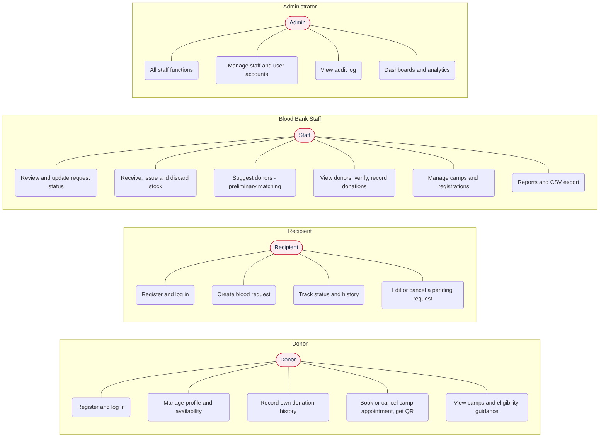

## 10. Class diagram
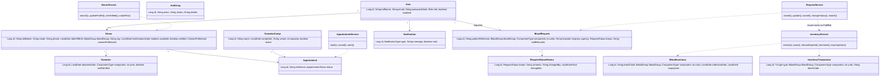

## 11. Entity Relationship (ER) diagram
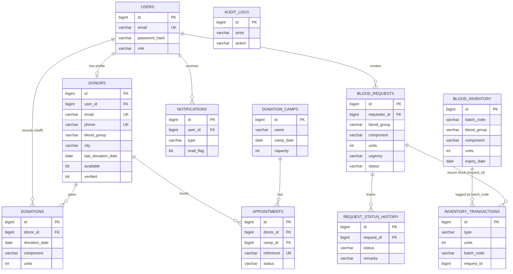

## 12. Data Flow Diagrams
**Level 0 (context diagram)**
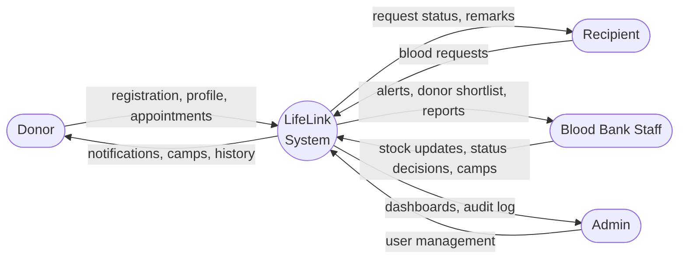

**Level 1**
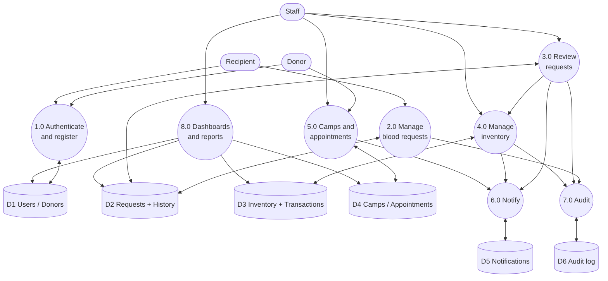

## Request workflow (state diagram)
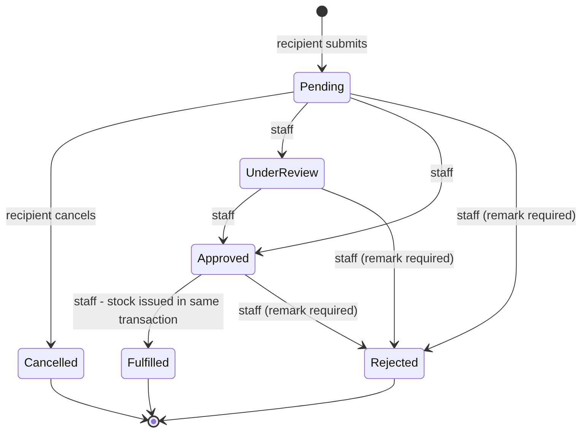

## 13. Database schema
The full DDL is in `database/schema.sql`. Summary:

| Table | Purpose | Key constraints |
|---|---|---|
| users | login accounts | unique e-mail; role check; BCrypt hash |
| donors | donor profile | unique e-mail and phone; FK to users |
| donations | donation history | FK donor; units 1-4 |
| blood_requests | recipient requests | FK requester; units 1-20; indexes on status/group/created |
| request_status_history | every status change | FK request |
| blood_inventory | stock batches | `units >= 0`; `expiry_date > collection_date`; index group+component |
| inventory_transactions | ledger of RECEIVED/ISSUED/DISCARDED | `units > 0` |
| donation_camps | camps | `end_time > start_time` |
| appointments | camp bookings | unique reference; FKs donor, camp |
| notifications | in-app messages | FK user; index user+read |
| audit_logs | audit trail | index created_at |

By default Hibernate (`ddl-auto=update`) creates the tables automatically; `schema.sql` is provided for manual set-up and for the report.

## 14. Module descriptions

| Module | What it does | Main classes |
|---|---|---|
| Authentication and roles | login, logout, registration, BCrypt, URL rules, CSRF | `SecurityConfig`, `AppUserDetailsService`, `UserService`, `HomeController` |
| Donor management | profile, search, verification, donation history | `DonorService`, `DonationService`, `DonorController`, `DonorSelfController` |
| Blood requests | create/edit/cancel, workflow, history, emergency highlight | `RequestService`, `RequestController` |
| Inventory | batches, receive/issue/discard, alerts, ledger | `InventoryService`, `InventoryController`, `BloodInventoryRepository` |
| Donor matching | preliminary shortlist with reasons | `DonorService.matchFor`, `requests/matches.html` |
| Camps and appointments | camps, booking, QR reference, registrations | `CampService`, `AppointmentService`, controllers |
| Notifications | in-app alerts for status, emergency, stock, expiry, camps | `NotificationService` |
| Dashboards and analytics | role dashboards and Chart.js charts | `DashboardService`, `dashboard/*.html` |
| Reports | summary, tables, CSV | `ReportService`, `ReportController` |
| Administration and audit | staff accounts, enable/disable, audit log | `AdminController`, `AuditService` |
| Internationalisation | English / Kannada navigation and main pages | `messages*.properties`, `WebConfig` |

### Key design decisions
- **Stock as batches.** Each receipt is a batch with its own expiry. Issuing locks the usable batches (`PESSIMISTIC_WRITE`) and consumes earliest-expiry first, so concurrent staff cannot overdraw stock. `@Version` on the batch adds optimistic protection.
- **Fulfilment is atomic.** `RequestService.changeStatus(FULFILLED)` calls `InventoryService.issue` inside the same transaction.
- **Components never mix.** All stock queries filter on blood group *and* component.
- **Privacy.** Donor contact details are only rendered in `/donors/**` and the matching page, which require Admin/Staff. Donor CSV omits e-mail, phone and address.
- **Matching is advisory.** It filters only by group, city, availability, last-donation reminder interval (configurable, default 90 days, *not* a medical rule) and shows staff verification. It states that compatibility and eligibility are decided by professionals.

## Additional UML diagrams
**System flowchart**
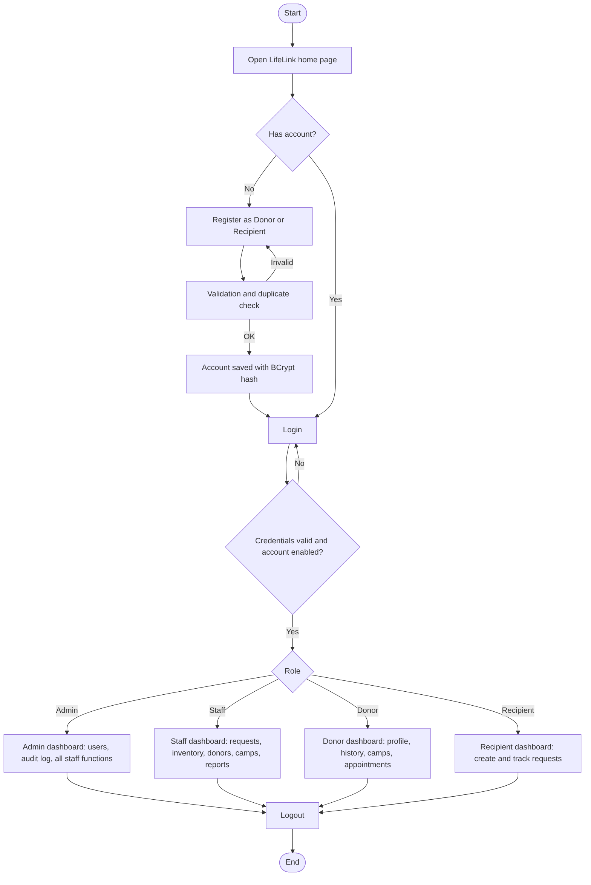

**Sequence diagram - login**
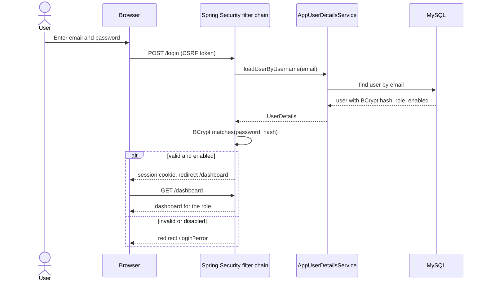

**Sequence diagram - request creation and fulfilment**
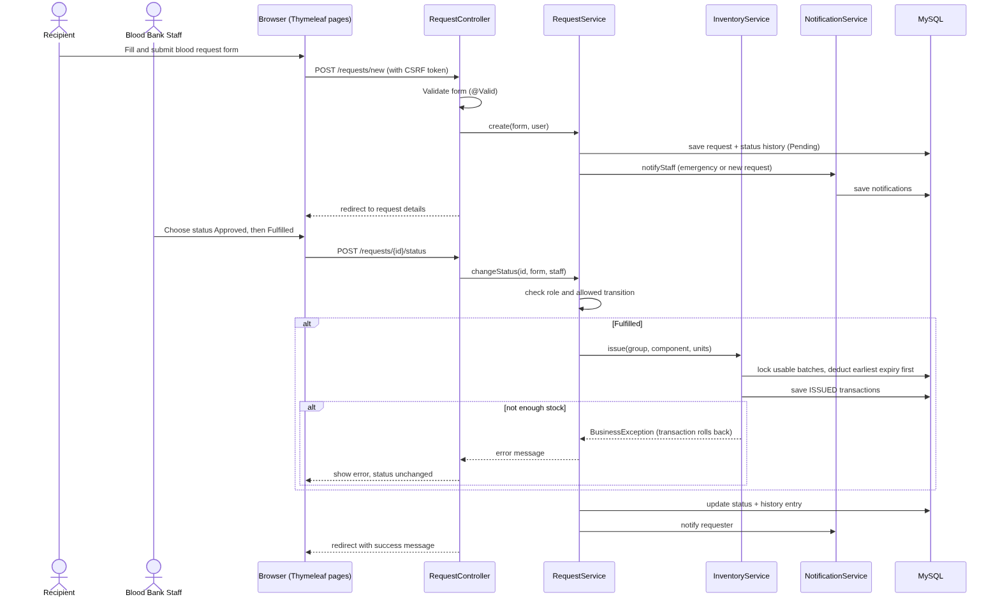

**Activity diagram - request and stock handling**
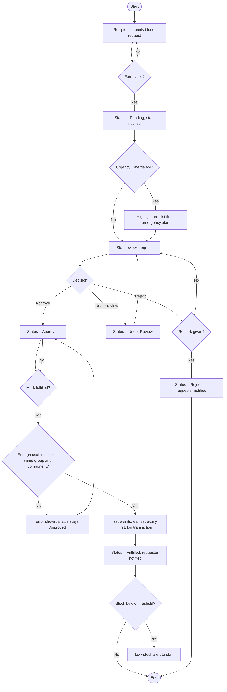

**Activity diagram - donor appointment**
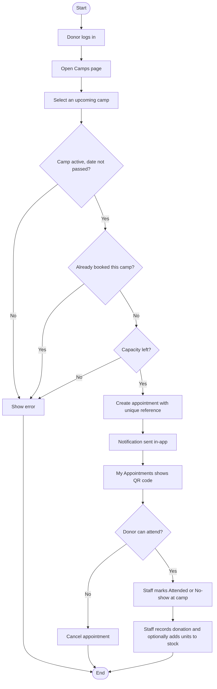

## REST API (small, read-only)
| Method and URL | Access | Returns |
|---|---|---|
| `GET /api/public/stats` | everyone | `{donors, units, camps}` counts (no personal data) |
| `GET /api/inventory/stock` | Admin, Staff | usable units per blood group and component |

`frontend/js/live-stats.js` calls the first one every 30 seconds to refresh the home-page figures. All other screens are server-rendered by Thymeleaf.
