# LifeLink - Smart Blood Donation and Blood Bank Management System
## MCA Final Year Project Report

**Student:** ______________________  **Register No.:** ______________  **College:** UBDT College of Engineering
**Guide:** ______________________  **Academic year:** ______________

> Fill in the blanks above. This report is the combination of the files in the `docs/` folder and describes the project as implemented. Items marked "not implemented" are not claimed as complete. The automated tests were written but must be run by you (see Test Plan, "Test execution status").

## Contents
1. Synopsis, abstract, objectives, existing/proposed system, requirements
2. Software Requirements Specification
3. System architecture
4. System design and modules (UML, ER, DFD, flowchart, sequence, activity diagrams)
5. Test plan and test cases
6. Installation and user manual
7. Future enhancements, conclusion, limitations
8. Appendix - viva questions

---
# LifeLink - Smart Blood Donation and Blood Bank Management System

**MCA Final-Year Project**

## 1. Project synopsis

LifeLink is a web application that brings blood donors, patients' families (recipients), blood bank staff and administrators onto one secure platform. Donors register and manage their profile and availability, book appointments at donation camps and keep a donation history. Recipients raise blood requests and follow them through a defined workflow. Blood bank staff manage component-wise inventory with expiry and low-stock alerts, review requests, record donations and use a preliminary donor-matching helper. Administrators manage staff accounts, view analytics and the audit log.

**Technology:** Java 21, Spring Boot 3.3 (Spring MVC, Spring Data JPA/Hibernate, Spring Security with BCrypt), Thymeleaf, Bootstrap 5, Chart.js, MySQL 8, Maven, JUnit 5.

## 2. Abstract

Blood banks in many places still depend on registers, phone calls and spreadsheets. This causes slow response to emergencies, poor visibility of stock and expiry, and no reliable history of requests. LifeLink digitises these processes. It provides role-based access (Admin, Staff, Donor, Recipient), a request workflow (Pending -> Under Review -> Approved -> Fulfilled, or Rejected/Cancelled) with a complete status history, component-wise inventory (whole blood, red cells, platelets, plasma) managed with database transactions so stock can never become negative, donation camps with appointment booking and QR references, in-app notifications for emergencies, low stock and expiry, database-driven dashboards with charts, date-filtered reports with CSV export and an audit log.

LifeLink is an *assistance and management* tool. It does **not** decide medical eligibility, blood compatibility, cross-matching or release of blood; these remain the responsibility of qualified blood bank professionals. The donor-matching feature is clearly labelled as preliminary.

## 3. Problem statement

1. Patients' families struggle to find which blood group and component is available and to follow the progress of a request.
2. Blood banks lack a single view of stock by group and component, of near-expiry batches and of low-stock situations.
3. Donor records are scattered; contacting suitable donors for urgent needs is slow and privacy is hard to protect.
4. Camps, appointments and donation histories are managed manually.
5. There is no audit trail of who changed a request or stock and when.

## 4. Objectives and scope

### Objectives
- Provide secure, role-based access with hashed passwords and protected routes.
- Manage donors, donations, camps and appointments.
- Manage blood requests with an enforced status workflow, remarks and history.
- Maintain component-wise inventory with transactions, alerts and movement history.
- Offer preliminary donor matching with transparent reasons.
- Present live dashboards, reports and CSV export.
- Keep an audit log of important actions.

### In scope (implemented)
Authentication and roles; donor module; request module; inventory module; matching helper; camps and appointments with QR code; notifications (in-app); dashboards and charts; reports and CSV; audit log; English/Kannada interface for navigation and main public pages; FAQ page with keyword help search; demo data (labelled DEMO).

### Out of scope / not implemented
E-mail or SMS delivery, online payments, hospital system integration (HL7/FHIR), mobile apps, GPS/maps, full Kannada translation of every page, password-reset by e-mail, medical eligibility rules, automatic cross-matching.

---

# Existing and Proposed Systems, Requirements

## 5. Existing and proposed systems

### Existing (manual or semi-manual) system
- Paper registers or spreadsheets for donors and stock.
- Requests by phone or walk-in; no visible status for the family.
- Expiry and low stock noticed only by manual checking.
- No role separation and no audit trail; personal data widely visible.

### Limitations of the existing system
Slow response, human error in stock counts, duplicated donor entries, no analytics, no accountability, privacy risks.

### Proposed system - LifeLink
| Aspect | Proposed solution |
|---|---|
| Access | Role-based login (Admin, Staff, Donor, Recipient), BCrypt passwords, CSRF protection |
| Requests | Online request with urgency, enforced workflow, remarks, history, notifications |
| Inventory | Batch-wise stock per group and component, FIFO by earliest expiry, no negative stock, ledger of movements |
| Donors | Registration with duplicate checks, search by group/city, staff verification flag, contact details only for staff |
| Camps | Create camps, book/cancel appointments, QR reference, staff registration list |
| Insight | Dashboards, charts, reports, CSV export, audit log |

### Advantages
Faster response, transparency, accurate stock with expiry control, privacy by design, measurable operations.

## 6. Software and hardware requirements

### Software
| Item | Requirement |
|---|---|
| Operating system | Windows 10/11 (also Linux/macOS) |
| JDK | Java 21 (e.g. Temurin / OpenJDK 21) |
| Build tool | Apache Maven 3.9+ (or the IDE's bundled Maven) |
| Database | MySQL 8.x |
| Browser | Current Chrome, Edge or Firefox (Internet needed for CDN libraries: Bootstrap, Chart.js, QR, fonts) |
| IDE | IntelliJ IDEA or VS Code with the Java extension pack (enable annotation processing for Lombok) |

### Hardware (minimum)
- Dual-core CPU, 4 GB RAM (8 GB recommended), 1 GB free disk, network connection.

---

# Software Requirements Specification (SRS)

## 1. Introduction
**Purpose.** Defines the requirements of LifeLink. **Intended readers:** project guide, examiners, developers, testers. **Product scope:** see Synopsis.

## 2. Overall description
- **Product perspective:** stand-alone web application, three-tier (browser, Spring Boot server, MySQL).
- **User classes:** Administrator, Blood Bank Staff, Donor, Recipient.
- **Operating environment:** Java 21 JVM, MySQL 8, modern browser.
- **Constraints:** notifications are in-app only; medical decisions are outside the system.
- **Assumptions:** staff enter stock accurately; users have internet for CDN assets.

## 3. Functional requirements

| ID | Requirement | Actor |
|---|---|---|
| FR-1 | Register as donor (name, DOB, gender, blood group, phone, e-mail, city, address, optional last donation, contact preference) | Donor |
| FR-2 | Register as recipient | Recipient |
| FR-3 | Log in / log out; accounts can be disabled | All |
| FR-4 | Reject duplicate e-mail or phone; reject under-18 donor accounts; passwords need 8+ chars with letters and digits | System |
| FR-5 | Donor edits profile, availability, contact preference | Donor |
| FR-6 | Donor adds own donation history (shown as self-reported) | Donor |
| FR-7 | Staff/admin search and filter donors by group, city, text, availability, verified | Staff, Admin |
| FR-8 | Staff verify donors, edit donors, record donations (optionally add units to stock) | Staff, Admin |
| FR-9 | Recipient creates a request: patient reference, group, component, units, hospital, city, phone, required date, urgency | Recipient |
| FR-10 | Recipient views history, edits or cancels while Pending | Recipient |
| FR-11 | Staff change status along the allowed workflow; rejection needs a remark; every change stored in history | Staff, Admin |
| FR-12 | Fulfilling a request issues stock in the same transaction; fails if stock is insufficient | System |
| FR-13 | Emergency requests are highlighted, listed first and notify all staff | System |
| FR-14 | Staff receive and issue stock per group and component; batches have collection and expiry dates | Staff, Admin |
| FR-15 | Stock never negative; expired units are excluded and can be written off | System |
| FR-16 | Low-stock and expiry alerts as in-app notifications | System |
| FR-17 | Inventory movement history with filters | Staff, Admin |
| FR-18 | Preliminary donor matching: group, city, availability, last donation, verification; shows reasons and a disclaimer | Staff, Admin |
| FR-19 | Create/edit/cancel camps; donors book/cancel appointments; QR reference; staff see registrations and mark attendance | Staff, Donor |
| FR-20 | Role-specific dashboards with live figures and charts | All |
| FR-21 | Reports by date range with summary, tables, CSV export (donor CSV has no contact data) and print | Staff, Admin |
| FR-22 | Audit log of important actions | Admin |
| FR-23 | English/Kannada switch; FAQ and keyword help | All |
| FR-24 | Admin creates staff/admin accounts and enables/disables users | Admin |

## 4. Non-functional requirements
- **Security:** BCrypt hashing, CSRF, role-based URL rules plus ownership checks in services, server-side validation, no secrets in code (environment variables), generic error pages without stack traces.
- **Reliability:** transactional stock changes with pessimistic locking and optimistic version field.
- **Usability:** responsive Bootstrap UI, clear validation messages, success/error notifications.
- **Performance:** indexed columns for search; suitable for a single blood bank.
- **Maintainability:** layered architecture (controller, service, repository), tests for important rules.
- **Privacy:** contact details only for staff/admin; CSV exports omit contact data.

## 5. External interfaces
Browser (HTTP/HTML), MySQL via JDBC, CDN for Bootstrap, Bootstrap Icons, Chart.js, qrcode.js and Google Fonts.

## 6. Status workflow rules
Pending -> Under Review | Approved | Rejected; Under Review -> Approved | Rejected; Approved -> Fulfilled | Rejected; Pending -> Cancelled (requester only). Fulfilled, Rejected and Cancelled are final.

---

# System Architecture

LifeLink is a three-layer Spring Boot web application (Java 21) with a MySQL 8 database.

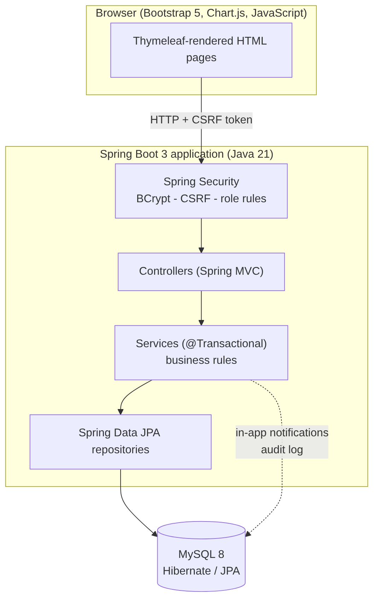

## Layers
1. **Presentation (frontend/)** - Thymeleaf pages (`frontend/pages`), shared layout fragments (`frontend/components`), CSS, JavaScript and images. Bootstrap 5, Bootstrap Icons, Chart.js and qrcode.js are loaded from CDNs.
2. **Business (backend/)** - Spring MVC controllers handle requests and validation; services hold business rules and are `@Transactional`; Spring Security protects URLs.
3. **Data (database/)** - Spring Data JPA repositories over MySQL via Hibernate.

## How the folders map to Spring Boot
Spring Boot expects `src/main/java`, `templates/` and `static/`. To keep a clear project layout, `pom.xml` declares:

| Folder in project | Becomes on the classpath |
|---|---|
| `backend/src/main/java` | compiled Java classes |
| `backend/src/main/resources` | `application.properties`, `messages*.properties` |
| `frontend/pages` | `templates/` |
| `frontend/components` | `templates/fragments/` |
| `frontend/css`, `js`, `images` | `static/css`, `static/js`, `static/images` |
| `tests/backend-tests/java` and `resources` | test sources and test configuration |

## Backend packages (`backend/src/main/java/com/lifelink/`)
| Package | Purpose |
|---|---|
| `config` | `SecurityConfig` (roles, CSRF, BCrypt), `AppUserDetailsService`, `WebConfig` (language switch), `DemoDataLoader` |
| `controller` | page controllers (Home, Dashboard, Donor, Request, Inventory, Camp, Appointment, Notification, Report, Admin) and `ApiController` (REST) |
| `service` | business rules: Inventory, Request, Donor, Donation, Camp, Appointment, Notification, Dashboard, Report, Audit, User |
| `repository` | Spring Data JPA interfaces |
| `model` | JPA entities and enums |
| `dto` | validated form objects |
| `exception` | `BusinessException`, `NotFoundException` |

## Frontend-backend communication
- Pages are rendered on the server (Thymeleaf) and forms are submitted with POST including a CSRF token.
- Charts receive their data from the model through Thymeleaf JavaScript inlining.
- A small JSON REST API (`/api/public/stats`, `/api/inventory/stock`) is available; the home page refreshes its live figures from it.

## Security architecture
BCrypt password hashes; URL rules per role in `SecurityConfig`; ownership checks inside services; server-side validation with Jakarta Validation; CSRF enabled; sessions with HttpOnly cookies and session-fixation protection; generic error pages (no stack traces); secrets read from environment variables or `.env`.

## Transactions and concurrency
Stock issue runs in a transaction, locks usable batches (`PESSIMISTIC_WRITE`), deducts earliest expiry first and rolls back on shortage. Marking a request Fulfilled and issuing its stock happen in the same transaction. `@Version` on batches adds optimistic locking.

## Deployment
Single executable JAR (`mvn package` -> `target/lifelink.jar`) or `mvn spring-boot:run`; MySQL on the same or another machine; configuration through environment variables.

---

# System Design and Modules

## 9. Use-case diagram
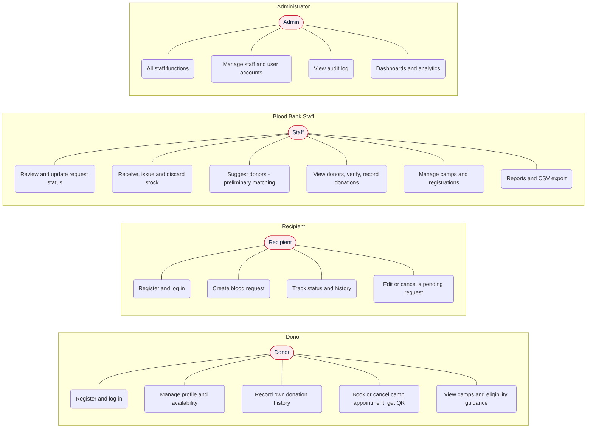

## 10. Class diagram
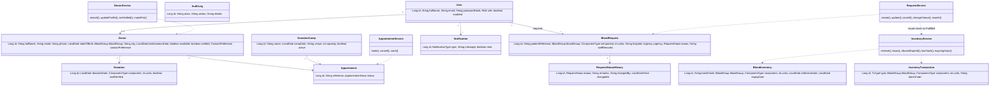

## 11. Entity Relationship (ER) diagram
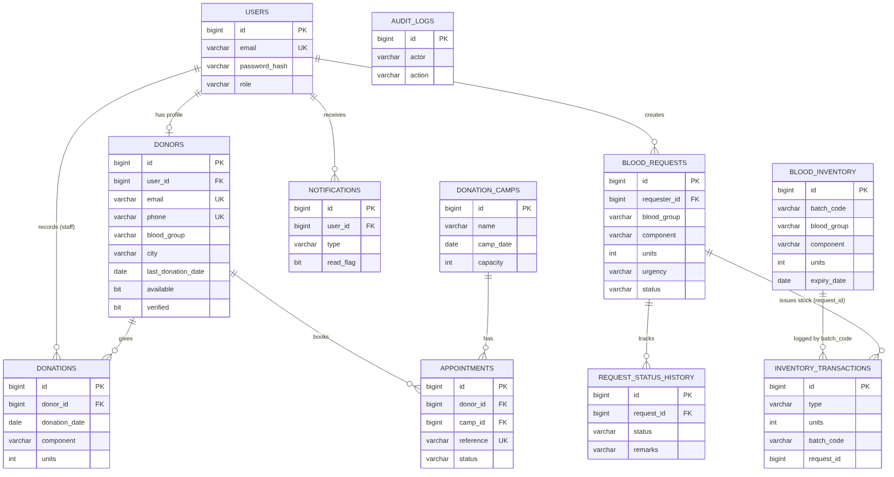

## 12. Data Flow Diagrams
**Level 0 (context diagram)**
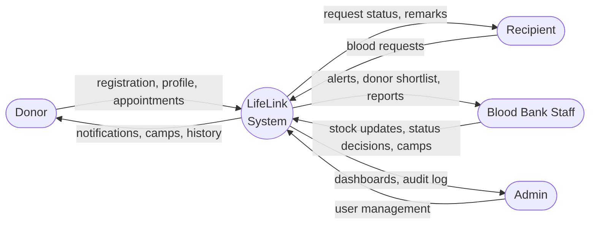

**Level 1**
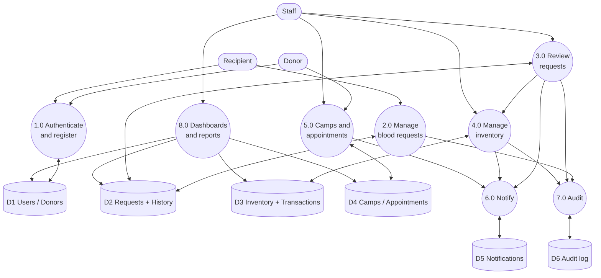

## Request workflow (state diagram)
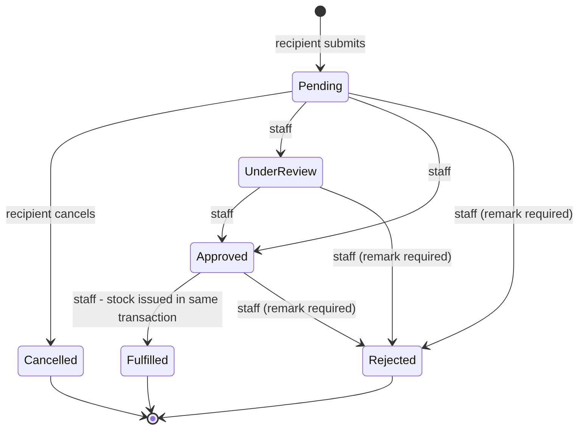

## 13. Database schema
The full DDL is in `database/schema.sql`. Summary:

| Table | Purpose | Key constraints |
|---|---|---|
| users | login accounts | unique e-mail; role check; BCrypt hash |
| donors | donor profile | unique e-mail and phone; FK to users |
| donations | donation history | FK donor; units 1-4 |
| blood_requests | recipient requests | FK requester; units 1-20; indexes on status/group/created |
| request_status_history | every status change | FK request |
| blood_inventory | stock batches | `units >= 0`; `expiry_date > collection_date`; index group+component |
| inventory_transactions | ledger of RECEIVED/ISSUED/DISCARDED | `units > 0` |
| donation_camps | camps | `end_time > start_time` |
| appointments | camp bookings | unique reference; FKs donor, camp |
| notifications | in-app messages | FK user; index user+read |
| audit_logs | audit trail | index created_at |

By default Hibernate (`ddl-auto=update`) creates the tables automatically; `schema.sql` is provided for manual set-up and for the report.

## 14. Module descriptions

| Module | What it does | Main classes |
|---|---|---|
| Authentication and roles | login, logout, registration, BCrypt, URL rules, CSRF | `SecurityConfig`, `AppUserDetailsService`, `UserService`, `HomeController` |
| Donor management | profile, search, verification, donation history | `DonorService`, `DonationService`, `DonorController`, `DonorSelfController` |
| Blood requests | create/edit/cancel, workflow, history, emergency highlight | `RequestService`, `RequestController` |
| Inventory | batches, receive/issue/discard, alerts, ledger | `InventoryService`, `InventoryController`, `BloodInventoryRepository` |
| Donor matching | preliminary shortlist with reasons | `DonorService.matchFor`, `requests/matches.html` |
| Camps and appointments | camps, booking, QR reference, registrations | `CampService`, `AppointmentService`, controllers |
| Notifications | in-app alerts for status, emergency, stock, expiry, camps | `NotificationService` |
| Dashboards and analytics | role dashboards and Chart.js charts | `DashboardService`, `dashboard/*.html` |
| Reports | summary, tables, CSV | `ReportService`, `ReportController` |
| Administration and audit | staff accounts, enable/disable, audit log | `AdminController`, `AuditService` |
| Internationalisation | English / Kannada navigation and main pages | `messages*.properties`, `WebConfig` |

### Key design decisions
- **Stock as batches.** Each receipt is a batch with its own expiry. Issuing locks the usable batches (`PESSIMISTIC_WRITE`) and consumes earliest-expiry first, so concurrent staff cannot overdraw stock. `@Version` on the batch adds optimistic protection.
- **Fulfilment is atomic.** `RequestService.changeStatus(FULFILLED)` calls `InventoryService.issue` inside the same transaction.
- **Components never mix.** All stock queries filter on blood group *and* component.
- **Privacy.** Donor contact details are only rendered in `/donors/**` and the matching page, which require Admin/Staff. Donor CSV omits e-mail, phone and address.
- **Matching is advisory.** It filters only by group, city, availability, last-donation reminder interval (configurable, default 90 days, *not* a medical rule) and shows staff verification. It states that compatibility and eligibility are decided by professionals.

## Additional UML diagrams
**System flowchart**
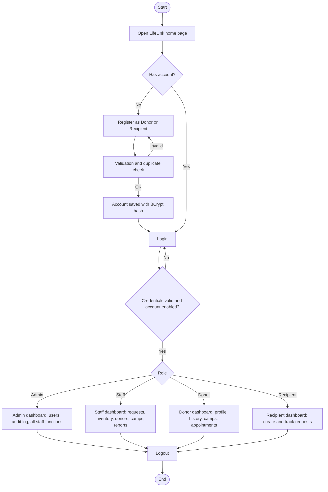

**Sequence diagram - login**
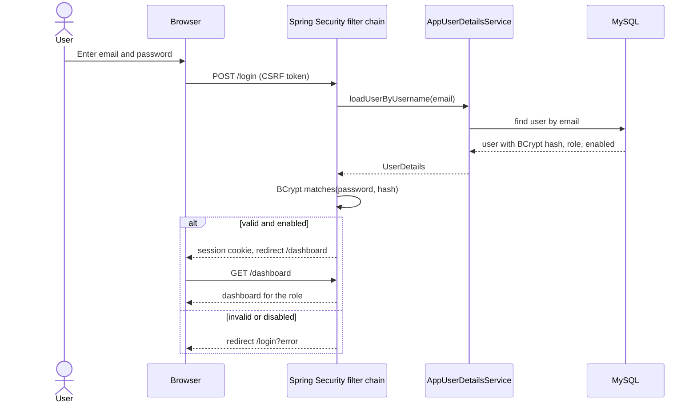

**Sequence diagram - request creation and fulfilment**
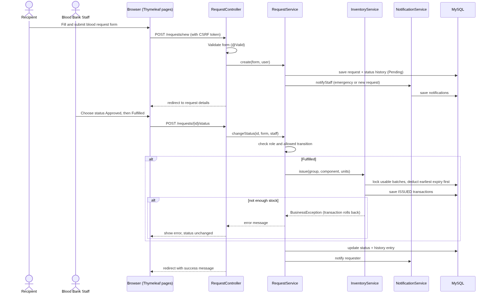

**Activity diagram - request and stock handling**
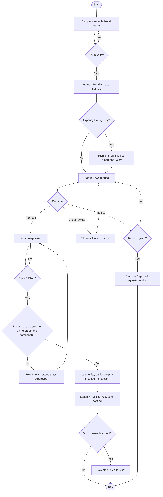

**Activity diagram - donor appointment**
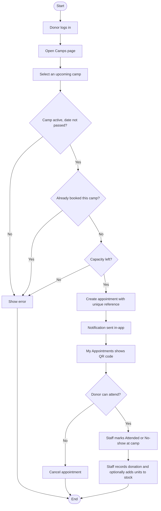

## REST API (small, read-only)
| Method and URL | Access | Returns |
|---|---|---|
| `GET /api/public/stats` | everyone | `{donors, units, camps}` counts (no personal data) |
| `GET /api/inventory/stock` | Admin, Staff | usable units per blood group and component |

`frontend/js/live-stats.js` calls the first one every 30 seconds to refresh the home-page figures. All other screens are server-rendered by Thymeleaf.

---

# Test Plan and Test Cases

## 15. Test strategy
- **Unit/service tests** (JUnit 5 + Spring Boot Test, in-memory H2 in MySQL mode, each test rolled back).
- **Web tests** (MockMvc with Spring Security Test): authentication, CSRF, role access, page rendering.
- **Validation tests** (Jakarta Validation without Spring).
- **Manual UAT** with the demo accounts (checklist below).

## Automated test classes (`tests/backend-tests/java`)
| Class | Covers |
|---|---|
| `LifeLinkApplicationTests` | Spring context, entity mappings |
| `InventoryServiceTests` | receive, issue, FIFO by expiry, no negative stock, components separate, expired stock unusable and discard, low-stock and expiry lists, input validation |
| `RequestServiceTests` | create, workflow transitions, rejection remark, fulfil issues stock, insufficient stock keeps status, recipient cannot change status, ownership checks, edit/cancel only when Pending, recipient sees only own requests, emergency ordering, emergency notification |
| `DonorServiceTests` | registration + BCrypt, duplicate e-mail/phone, password mismatch, under-18, search by group/city/text, `%` treated literally, verification, matching rules |
| `FormValidationTests` | bean-validation rules for request, donor, stock forms |
| `ReportServiceTests` | CSV escaping and formula-injection protection |
| `ApiWebTests` | REST API: public stats open and JSON, stock API staff-only |
| `AuthWebTests` | public pages, Kannada switch, registration success/failure, CSRF, login success/failure/disabled, redirect to login |
| `RoleAccessWebTests` | 403 for wrong roles, status change only by staff, privacy of other users' requests, all dashboards/pages render, request and stock forms, CSV privacy, camp booking |

## Manual test cases
| # | Scenario | Steps | Expected |
|---|---|---|---|
| M1 | Donor registration | Register with valid data | Redirect to login with success message |
| M2 | Duplicate e-mail | Register again with same e-mail | Error "account already exists" |
| M3 | Weak password | Use `abc` | Field error on password |
| M4 | Login wrong password | Enter wrong password | "Invalid email or password" |
| M5 | Role protection | Log in as donor, open `/inventory` | Access denied page |
| M6 | Create request | Recipient submits request | Shown as Pending; staff get notification |
| M7 | Emergency | Submit with urgency Emergency | Highlighted red row, listed first |
| M8 | Status workflow | Staff: Pending -> Under Review -> Approved -> Fulfilled | History shows 4 entries; recipient notified |
| M9 | Reject without remark | Staff rejects with empty remark | Error message |
| M10 | Fulfil without stock | Approve and fulfil a request for an empty stock combination | Error "Not enough usable stock", status stays Approved |
| M11 | Receive stock | Add 10 units O+ red cells | Matrix increases by 10; movement logged |
| M12 | Issue too many | Issue more than available | Error, stock unchanged |
| M13 | Low stock | Reduce a group below threshold | Red cell in matrix; notification |
| M14 | Expiry | Receive batch expiring in 3 days | Shown under "Expiring soon" |
| M15 | Matching | Open "Suggest donors" | Shortlist with reasons and disclaimer |
| M16 | Camp booking | Donor books camp; books again | First OK with QR; second refused |
| M17 | Cancel appointment | Donor cancels | Status Cancelled |
| M18 | Reports | Choose date range, export CSV | Summary and file download |
| M19 | Language | Click Kannada | Navigation and login texts in Kannada |
| M20 | Responsive | Resize to phone width | Navbar collapses, tables scroll |

## Test execution status (honest disclosure)
> The automated tests and manual cases above were **written together with the code**. The environment in which the project was generated could not reach Maven Central, so `mvn test` and `mvn package` **could not be run there**. The sources were checked for syntax (`javac` parse), and cross-checked for consistent field/property names, message keys and template names, but **not compiled against Spring or executed**.
> **Before your demonstration, run `mvn clean test` on your own computer** (see the installation manual) and fix anything it reports. Record the result in the table below.

| Run | Date | Tests run | Failures | Notes |
|---|---|---|---|---|
| 1 | | | | |

## Frontend tests
See `tests/frontend-tests/frontend-test-checklist.md` (manual browser checklist) and `tests/frontend-tests/check-frontend-files.ps1` (checks that every page, CSS, JS and image file exists). Page rendering is also covered by the automated MockMvc tests.

---

# Installation and User Manual

## 16.1 Installation (Windows)
See the step-by-step guide in the project's `README.md` (or double-click `windows/run-project.bat`). In short: install JDK 21, Maven and MySQL 8; create `.env` from `.env.example`; run `mvn spring-boot:run`; open http://localhost:8080.

## 16.2 Demo accounts (DEMO data)
| Role | E-mail | Password |
|---|---|---|
| Admin | admin@lifelink.demo | Demo@12345 |
| Staff | staff@lifelink.demo | Demo@12345 |
| Donor | donor@lifelink.demo | Demo@12345 |
| Recipient | recipient@lifelink.demo | Demo@12345 |

The password comes from `DEMO_PASSWORD` in `.env`. Set `DEMO_DATA_ENABLED=false` for a clean database. All demo rows carry a **DEMO** badge.

## 16.3 User manual
### Donor
1. Register (Register -> I want to donate blood). 2. Log in; the dashboard shows blood group, donation count, reminder date and upcoming camps. 3. *My Profile* - update contact details, availability, contact preference. 4. *Donation History* - add past donations (self-reported). 5. *Camps* - book an appointment; *My Appointments* shows the QR code; cancel if needed. 6. Bell icon - notifications.

### Recipient
1. Register (I need blood). 2. *New Request* - fill patient reference, group, component, units, hospital, city, phone, date, urgency. 3. *Blood Requests* - search/filter, open a request to see the status history and staff remarks. 4. Edit or cancel while the request is Pending.

### Blood bank staff
1. Dashboard - alerts, counts, charts. 2. *Blood Requests* - open a request, choose the next status, add remarks (required for rejection). Use *Suggest donors* for a preliminary shortlist. 3. *Inventory* - receive stock, issue stock, filter batches, discard expired units, view movement history. 4. *Donors* - search, verify, edit, record a donation (optionally add to stock). 5. *Camps* - create/edit/cancel camps, open registrations, mark attended/no-show. 6. *Reports* - choose dates, export CSV, print.

### Administrator
Everything staff can do, plus *Users* (create staff/admin, enable/disable) and *Audit Log*.

## 16.4 Troubleshooting
| Problem | Fix |
|---|---|
| `Access denied for user 'root'` | wrong `DB_PASSWORD` in `.env` |
| `Communications link failure` | MySQL not running / wrong port |
| `release version 21 not supported` | JDK older than 21 - install JDK 21 and set `JAVA_HOME` |
| Port 8080 busy | set `SERVER_PORT=8081` |
| Page looks unstyled / no charts | no internet access for CDN libraries |

---

# Future Enhancements, Conclusion and Limitations

## 17. Future enhancements
- Real e-mail/SMS/WhatsApp notifications through a configured provider (not implemented now).
- Password reset by e-mail, two-factor authentication.
- Map-based donor and camp search; distance filtering.
- Integration with hospital information systems and national blood bank registries.
- Barcode/RFID scanning of blood bags; cold-chain temperature monitoring.
- Full Kannada (and other languages) translation of every page.
- Mobile application and push notifications.
- Predictive stock forecasting from historical demand (requires real data and validation).
- Self-service data export / deletion for donors; stricter data-retention policies.
- Docker image and CI pipeline.

## 18. Conclusion
LifeLink demonstrates a complete, layered web application for blood donation and blood bank management. It combines secure role-based access, an enforced request workflow, transactional component-wise inventory, camp management and database-driven analytics, while deliberately leaving medical decisions to qualified professionals. The design keeps business rules in services, validates input on the server, protects personal data and records an audit trail. The project can be extended with real notification providers and integrations to move from a college demonstration to a pilot deployment.

## Limitations (honest summary)
- Notifications are in-app only.
- Kannada translation covers navigation, landing, login and common messages, not every page; translations should be reviewed by a native speaker.
- Library assets (Bootstrap, Chart.js, QR, fonts) load from CDNs and need internet.
- Default shelf-life values used to pre-fill expiry dates are generic defaults; staff must enter the real expiry from the bag label.
- The automated tests were written but could not be executed in the generation environment (see test-plan.md).

---

# Viva Questions with Answers

**1. What is LifeLink and what problem does it solve?**
A web application that manages blood donors, requests, inventory, camps and reports for a blood bank. It replaces manual registers with a secure, role-based system with live stock and request tracking.

**2. Why Spring Boot?**
It gives auto-configuration, an embedded server, easy integration with JPA, Security and Thymeleaf, and a clean layered structure; the project runs with a single `mvn spring-boot:run`.

**3. Explain the layered architecture.**
Controller (HTTP, validation, view selection) -> Service (business rules, transactions) -> Repository (database access with Spring Data JPA) -> MySQL. DTO classes carry validated form data; entities map tables.

**4. How are passwords protected?**
With BCrypt (`BCryptPasswordEncoder`): salted, slow, one-way hashes. Only the hash is stored; login compares using `matches()`.

**5. How is role-based access implemented?**
`SecurityConfig` maps URL patterns to roles (e.g. `/inventory/**` -> ADMIN or STAFF). Services repeat ownership checks (a recipient can only open their own request), and the UI hides links the role cannot use.

**6. What is CSRF and how is it handled?**
An attacker site makes the victim's browser send a state-changing request. Spring Security keeps CSRF protection on; Thymeleaf's `th:action` inserts a hidden token in every POST form, and requests without it get 403 (tested).

**7. How do you prevent SQL injection?**
All database access uses JPA repositories, JPQL and the Criteria API with bound parameters - no string-concatenated SQL. Search text also has `%` and `_` escaped.

**8. Describe the request workflow.**
Pending -> Under Review -> Approved -> Fulfilled; Rejected (remark required) from any open state; Cancelled by the requester while Pending. `RequestStatus.canMoveTo` enforces it and every change is stored in `request_status_history`.

**9. How do you prevent negative or inconsistent stock?**
Stock is stored in batches. `issue()` runs in a transaction, locks usable batches with `PESSIMISTIC_WRITE`, checks the total, then deducts earliest-expiry first. A DB check `units >= 0` and an `@Version` field give extra protection. If stock is insufficient the whole transaction is rolled back.

**10. What does @Transactional do?**
It wraps the method in a database transaction: either all changes commit or all roll back. Marking a request Fulfilled and issuing its stock happen in one transaction.

**11. Why are blood components tracked separately?**
Whole blood, red cells, platelets and plasma differ in use and shelf life and are not interchangeable. Every stock query filters on group and component.

**12. Does the system decide donor eligibility or blood compatibility?**
No. The matching helper only filters by group, city, availability, last-donation date and verification and shows its reasons with a disclaimer. Medical eligibility, testing, cross-matching and release are done by qualified professionals.

**13. What is the 90-day value in the project?**
A configurable *reminder interval* (`DONATION_INTERVAL_DAYS`) used to hide recently donated donors in the matching list and to show a reminder date. It is not a medical rule.

**14. How are low-stock and expiry alerts produced?**
`InventoryService.refreshAlerts()` runs hourly (`@Scheduled`) and after stock changes; it creates in-app notifications for staff, avoiding duplicates with a `dedupeKey`.

**15. How does the dashboard get its numbers?**
`DashboardService` queries repositories (counts, grouped queries) and passes lists to Chart.js through Thymeleaf JavaScript inlining. No live figure is hard-coded; demo rows are labelled DEMO.

**16. What are DTOs and why use them?**
Form classes with validation annotations (`@NotBlank`, `@Pattern`, ...). They keep entities safe from mass-assignment and give clear validation messages.

**17. Explain the ER relationships.**
User 1-0..1 Donor; Donor 1-* Donation and Appointment; User 1-* BloodRequest and Notification; BloodRequest 1-* StatusHistory; Camp 1-* Appointment; inventory transactions refer to batches (batch code) and optionally to requests.

**18. How is the Kannada option implemented?**
Spring `MessageSource` with `messages.properties` and `messages_kn.properties`; `LocaleChangeInterceptor` switches language with `?lang=kn` and the choice is kept in the session. Only navigation and main pages are translated.

**19. How is the QR code created?**
In the browser with the `qrcode.js` library from the appointment reference; the reference is unique per appointment.

**20. How did you test?**
JUnit 5 + Spring Boot Test with in-memory H2 for service rules; MockMvc with Spring Security Test for login, CSRF and role access; validation tests; manual UAT. (State honestly which results you obtained when you ran `mvn test`.)

**21. How are secrets handled?**
`application.properties` reads environment variables or a git-ignored `.env`; `.env.example` has placeholders only. Demo password is configurable and demo data can be disabled.

**22. What would you improve?**
E-mail/SMS notifications, password reset, full translation, maps, hospital integrations, Docker/CI.

**23. How do you protect privacy?**
Contact details only for staff/admin; donor CSV excludes contact fields; recipients see only their own requests; error pages hide stack traces; audit log of actions.

**24. Why Thymeleaf instead of a JavaScript framework?**
Server-side rendering keeps the project simple, secure (automatic HTML escaping and CSRF tokens) and beginner-friendly, while Chart.js and Bootstrap provide interactivity.

**25. What is the role of Hibernate `ddl-auto`?**
`update` creates/updates tables automatically on start. For production use `validate` with the SQL in `database/schema.sql`.

**26. How do the frontend and backend communicate?**
Mostly by server-side rendering: the browser sends HTTP requests (GET pages, POST forms with a CSRF token) and Spring MVC returns Thymeleaf-rendered HTML. A small JSON REST API (`/api/public/stats`, `/api/inventory/stock`) also exists, and the home page uses `fetch()` to refresh its live figures.

**27. Why are `frontend/` and `backend/` folders used if Spring Boot expects `src/main`?**
`pom.xml` maps them: `sourceDirectory` points to `backend/src/main/java`, and `<resources>` copies `frontend/pages` to `templates/`, `frontend/css|js|images` to `static/`, so the layout is clean without changing how Spring Boot runs.

---

